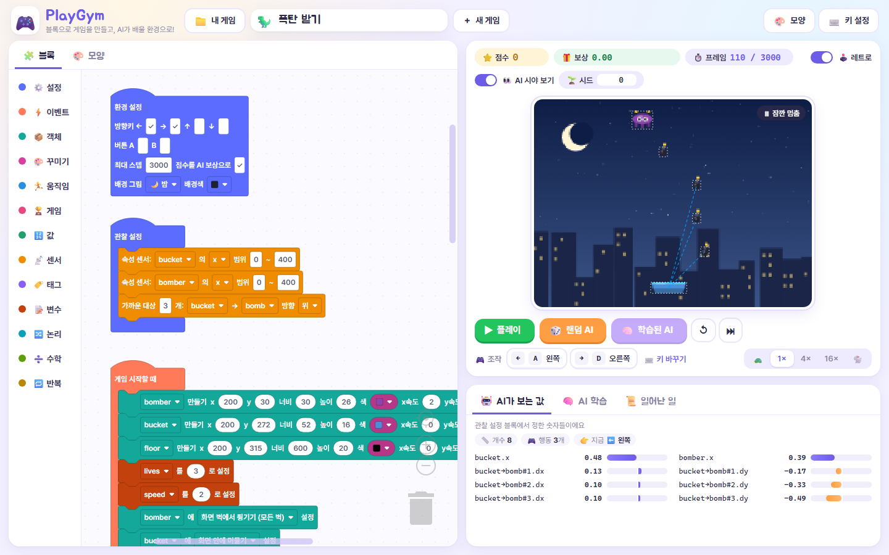
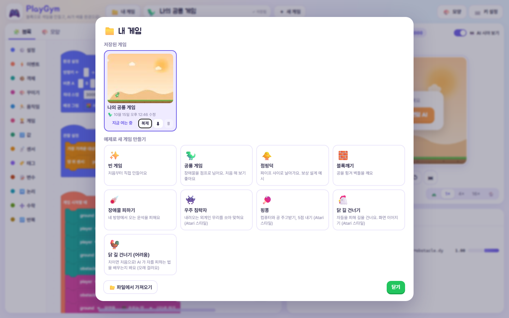
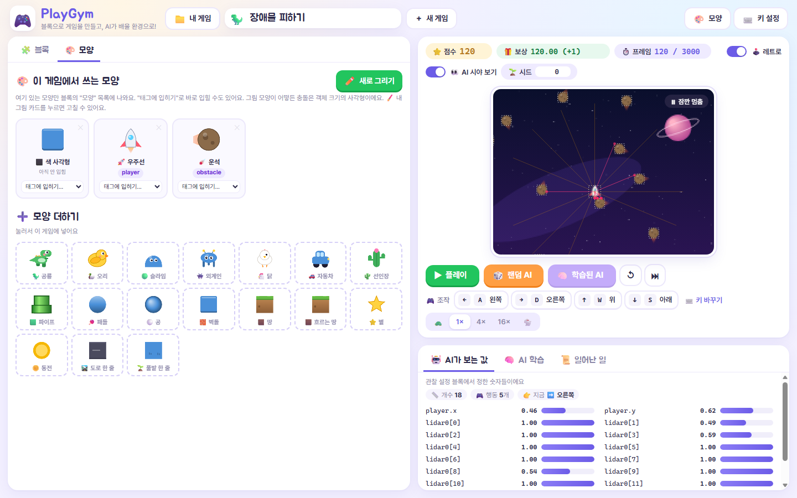
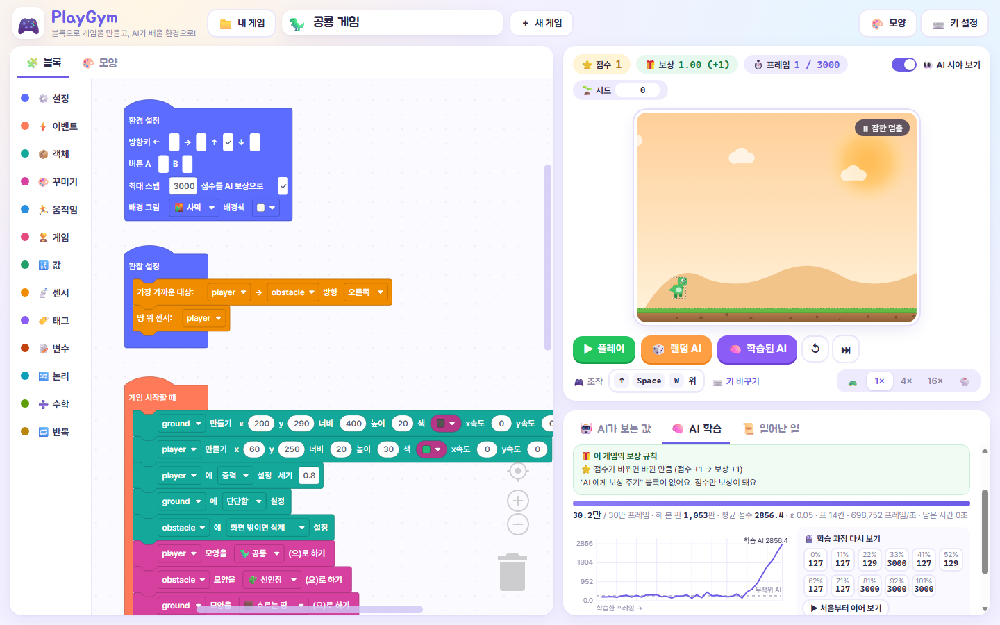

# 🎮 PlayGym

**블록으로 게임을 만들고, 그 게임을 AI 에게 가르쳐 보세요.**

PlayGym 은 중·고등학생을 위한 강화학습 놀이터입니다. 블록을 끼워 맞춰 공룡 점프, 블록깨기, 우주 침략자 같은
아케이드 게임을 만들면, 그 게임이 그대로 AI 의 연습장이 됩니다. AI 가 처음엔 엉망으로 하다가 점점 잘하게 되는
과정을 눈으로 지켜볼 수 있습니다.

설치는 필요 없습니다. 브라우저만 있으면 되고, AI 학습도 브라우저 안에서 돌아갑니다.

👉 **바로 해 보기: https://dorororong.github.io/PlayGym/**



---

## 무엇을 할 수 있나요?

### 1. 블록으로 게임 만들기

"게임 시작할 때 공룡을 만든다", "공룡이 선인장에 닿으면 게임 끝" 같은 문장을 블록으로 조립합니다.
중력, 벽에 튕기기, 화면 반대편으로 이어지기 같은 물리는 블록 하나로 켤 수 있어서, 처음 만드는 학생도
몇 분이면 움직이는 게임을 갖게 됩니다. 만든 게임은 ▶ 플레이로 직접 해 볼 수 있습니다.

좌표를 몰라도 됩니다. 블록의 **📍** 를 누르고 게임 화면에서 원하는 곳을 누르면 x, y 가 채워집니다.

### 2. 내 게임 모아 두기

만든 게임은 브라우저에 자동 저장되고, **📁 내 게임**에서 여러 개를 열고, 복제하고, 파일로 주고받을 수 있습니다.
예제 11가지로 시작해서 고쳐 나가도 됩니다.



| 예제 | 어떤 게임? |
| --- | --- |
| 🦖 공룡 게임 | 장애물을 점프로 넘기. AI 가 가장 빨리 배우는 첫 예제 |
| 🐥 점핑덕 | 파이프 사이로 날아가기. 보상 설계 연습용 |
| 🧱 블록깨기 | 공을 튕겨 벽돌 깨기 |
| ☄️ 장애물 피하기 | 네 방향에서 날아오는 운석 피하기 |
| 👾 우주 침략자 | 내려오는 외계인 쏘아 맞히기 |
| 🏓 핑퐁 | 컴퓨터와 공 주고받기, 5점 내기 |
| 💣 폭탄 받기 | 떨어지는 폭탄을 양동이로 받기. 3개 놓치면 끝 |
| 🦆 오리 사격장 | 지나가는 오리 쏘기. 3번 빗나가면 끝 |
| ⛷️ 스키 활강 | 깃발 사이로 내려가고 나무 피하기 |
| 🤹 막대 세우기 (CartPole) | 수레를 밀어 막대 세우기. 강화학습의 첫 예제로 가장 유명한 문제 |
| 🐍 뱀 게임 | 먹이를 먹으면 길어지는 그 게임. 벽과 내 몸을 피하기 |

게임 화면은 **200×150 픽셀**로 그려서 크게 늘려 보여 줍니다 (오락실 느낌, 🕹️ 레트로 스위치로 끌 수 있어요).
블록 화면과 게임 화면 사이, 게임 화면과 아래 패널 사이의 선을 끌면 크기를 바꿀 수 있습니다.

### 3. 모양 꾸미기

**🎨 모양** 탭에서 이 게임에 쓸 모양을 고릅니다. 공룡, 오리, 우주선, 외계인 같은 기본 모양을 넣거나,
16색 픽셀 편집기로 직접 그릴 수 있습니다. 카드에서 "태그에 입히기"를 고르면 블록을 찾아 다닐 필요 없이 바로 입혀집니다.
모양은 보이는 것만 바꿉니다. AI 가 보는 값이나 충돌에는 영향이 없습니다.



### 4. AI 에게 무엇을 보여 줄지 정하기

AI 는 화면을 보지 않습니다. 학생이 **관찰 설정** 블록으로 정해 준 숫자만 봅니다.
"가장 가까운 장애물까지의 거리", "공의 위치와 속도", "주변을 훑는 레이저(라이다)", "주변 칸에 차가 있는지(격자)" 등
센서 12가지를 조합하고, **👁️ 눈** 블록으로 원하는 곳에서 원하는 방향을 보는 눈을 여러 개 달 수 있습니다. **AI 시야 보기**를 켜면 AI 가 보는 것이 게임 화면 위에 그려집니다.

무엇을 보여 주느냐에 따라 AI 가 배우느냐 못 배우느냐가 갈립니다. 이것을 직접 바꿔 보는 것이 PlayGym 수업의 핵심입니다.

### 5. 보상 정하기

AI 는 **보상**이 커지도록 배웁니다. 보상은 두 가지로 줍니다.

- **점수** — 점수가 1 오르면 보상도 1. 환경 설정의 "점수를 AI 보상으로"로 켜고 끕니다.
- **"AI 에게 보상 주기" 블록** — 원하는 순간에 원하는 만큼. "살아 있는 동안 매 프레임 +0.1",
  "벽에 부딪히면 -1", "위로 올라간 만큼" 처럼 아무 이벤트 안에 넣을 수 있습니다.

AI 학습 탭의 **🎁 이 게임의 보상 규칙**에 지금 블록으로 정해진 보상이 문장으로 정리되고, 게임 화면 위
**보상** 칸에는 이번 판에 AI 가 받은 보상이 실시간으로 쌓입니다.

> 💡 해 볼 만한 실험: 뱀 게임에서 "100칸 동안 못 먹으면 끝" 블록을 빼고 학습시키면 AI 는 먹이를 찾는 대신 **빙빙 돌며 버티는 법**을 배웁니다.
> 보상과 규칙을 어떻게 정하느냐가 AI 의 행동을 정한다는 것을 바로 보여 주는 예입니다.

### 6. AI 학습시키고 지켜보기

**🧠 AI 학습** 탭에서 버튼 하나로 학습을 시작합니다. 학습은 브라우저 안에서 돌아가고, 쉬운 게임은 몇 초~몇 분이면 끝납니다.



- **학습 곡선**: 무작위로 누르는 AI 와 비교해서 얼마나 나아졌는지
- **실시간 보기**: 학습하는 동안 지금까지 배운 AI 가 게임 화면에서 계속 플레이
- **체크포인트 다시 보기**: 학습 0%, 10%, …, 100% 시점의 플레이를 녹화해 두었다가 다시 보기. "처음부터 이어 보기"로 AI 가 늘어 가는 과정을 한 번에
- **이어서 학습**: 부족하면 배운 데서부터 더 학습
- **🧠 학습된 AI** 버튼으로 다 배운 AI 의 플레이를 언제든 다시 보기

### 7. 학습 방법까지 직접 설계하기

**⚙️ 학습 설계**에서 학습 방법을 고를 수 있습니다. 기본값으로도 잘 되니 처음엔 건드리지 않아도 됩니다.

- **알고리즘 4가지**: Q-table(표로 외우기), DQN, REINFORCE, PPO
- **신경망 모양**: 층 수, 층마다 뉴런 수, 활성함수
- **학습 길이, 행동 유지 프레임, 할인율, 학습률, 시드**

같은 게임을 Q-table 과 신경망으로 각각 학습시켜 비교하는 수업이 가능합니다.

---

## 수업 흐름 예시 (2~3차시)

1. **공룡 게임 예제를 열어 직접 플레이**하고, 🎲 랜덤 AI 가 어떻게 하는지 봅니다.
2. **AI 학습**을 눌러 30초쯤 기다립니다. 학습 곡선이 올라가고, 학습된 AI 가 장애물을 넘습니다.
3. **관찰 설정 블록을 하나 빼고** 다시 학습합니다. 왜 못 배우는지 이야기합니다.
4. **보상을 바꿔 봅니다.** 점수 보상을 끄고 보상 블록만으로 가르쳐 보거나, 벌점을 주어 행동이 어떻게 달라지는지 봅니다.
5. **자기 게임을 만들고** AI 가 배울 수 있도록 관찰과 보상을 설계합니다.

## 얼마나 잘 배우나요?

일반 PC(i5-12500) 기준 실측입니다. 학교 노트북은 2~4배 느릴 수 있습니다.

| 게임 | 학습 시간 | 무작위 AI | 학습된 AI |
| --- | --- | --- | --- |
| 공룡 게임 | 약 15초 | 200점 | 3000점 (만점) |
| 블록깨기 | 약 1분 반 | 벽돌 1개 | 벽돌 8~24개 |
| 장애물 피하기 | 약 1분 반 | 120프레임 생존 | 260~390프레임 |
| 점핑덕 | 약 3분 | 파이프 0개 | 파이프 8~16개 |
| 막대 세우기 (CartPole) | 약 1분 | 43프레임 버팀 | 500프레임 (만점) |
| 뱀 게임 | 약 2분 | 먹이 0개 | 먹이 14~18개 |
| 폭탄 받기 | 약 2분 | 1개 | 123개 (거의 다 받음) |
| 스키 활강 | 약 4분 | 문 2개 | 문 16개 |
| 오리 사격장 | 약 1분 반 | 1마리 | 41마리 |

---

## 직접 실행하기

[Node.js](https://nodejs.org/) 20 이상이 필요합니다.

```bash
npm install
npm run dev
```

브라우저에서 http://localhost:5173 을 엽니다. `npm run build` 로 만든 `dist/` 는 아무 정적 웹 서버에 올려도 됩니다
(파일을 더블클릭해서 `file://` 로 열면 AI 학습이 막힙니다).

개발자를 위한 내용 — 폴더 구조, 명령줄 학습, Node·Python(Gymnasium)에서 환경으로 쓰기, 명세와 다르게 구현한 부분,
학습 실험 기록 — 은 **[docs/DEVELOPER.md](docs/DEVELOPER.md)** 에 있습니다.

## 만든 재료

TypeScript, [Blockly](https://github.com/google/blockly) (Apache 2.0), Vite. 신경망과 강화학습 알고리즘은 외부 라이브러리 없이 직접 구현했습니다.
게임 속 모양과 배경 그림은 모두 코드로 직접 그린 것입니다.

## 라이선스와 주의

- 제3자 구성요소와 라이선스는 [THIRD_PARTY_NOTICES.md](THIRD_PARTY_NOTICES.md) 에 있습니다.
- 다른 블록 코딩 도구나 원작 게임의 이름·로고·캐릭터·이미지·소리는 쓰지 않습니다. 예제는 일반 이름(공룡 게임, 블록깨기 등)을 씁니다.
- 학교·기관 이름으로 공개 배포하거나 상업적으로 쓸 때는 기관의 지식재산 담당 검토를 권합니다.
